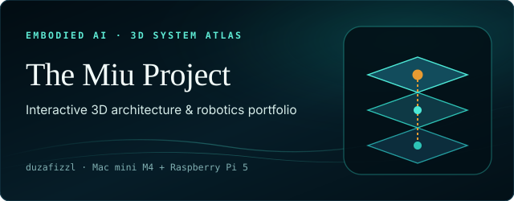
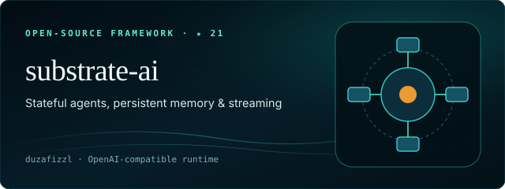
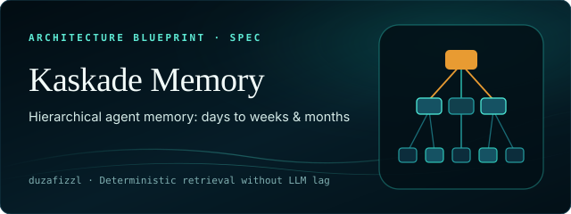
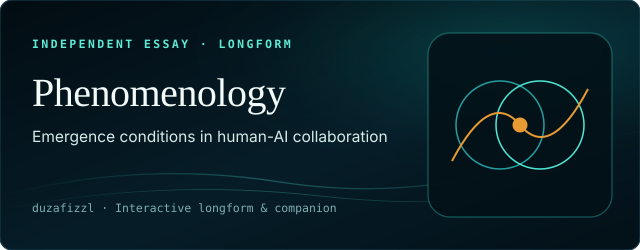
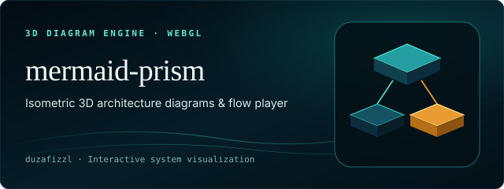
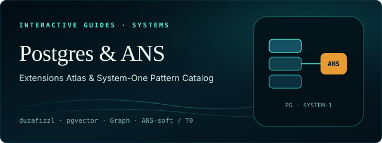
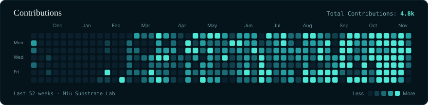

<!--
  File: README.md
  Description: Mobile- and Desktop-optimized GitHub profile README for Duzafizzl in the Liquid AI / Weight-Space Surgery LinkedIn CI style. Zero em-dashes, 3D Contribution City placed near the top.
  Created: 2026-11-12
  Last updated: 2026-11-12
-->

  

> **`01 · MEMORY & WEIGHT-SPACE` · Structured Memory & Weight Edits**  
> Replacing 100k-token prompt dumps with **PostgreSQL graph memory** (days rolling into weeks and months) and direct **model weight edits on Apple Silicon MLX** to fix model habits in seconds without retraining.
>
> **`02 · EMBODIED AI & ROBOTICS` · Real-Time Voice, Vision & Robotics**  
> Connecting one persistent agent across **LiveKit real-time voice**, **LiDAR depth perception**, and a **Raspberry Pi 5 robot** (`ROS 2`) for continuous person/object tracking, 3D room mapping, and hardware collision safety.
>
> **`03 · GOVERNANCE & QUALITY GATES` · AI Governance & Spec-Driven Building**  
> Operational **GenAI governance**, **EU AI Act** alignment, and technical implementability judgment, paired with **spec-driven development** where changes require deterministic verification gates before shipping.

  

## 📰 Featured Engineering Write-ups

<table>
<tr>
<td width="50%" valign="top">

### [Weight-Space Surgery: Rewriting Habits Inside Models](https://www.linkedin.com/pulse/weight-space-surgery-rewriting-habits-inside-models-clarissa-roethig-mbwfe/)
* **Surgical Hallucination Fix (Layer 22 · Col `#4543`):** Traced a German public-TV subtitle hallucination (*"Untertitelung des ZDF, 2020"* on silence) in `LFM3-Audio-2B` (`MLX bfloat16`) to a single MLP column and removed it in 4 seconds (`0.41%` of layer weights, zero retraining).
* **Covariance-Protected Voice Calibration:** Solved a regularized least-squares edit (`(XᵀX + λI)⁻¹`) on `LiquidCodec`, lifting target voice similarity (`-0.06 -> +0.24`) while holding German transcription Word Error Rate at `0.00`.
* **104k -> ~8k Token Memory Cascade:** Replaced a 6.7-second static prompt prefill with hot working memory, sub-2ms paragraph retrieval, and nightly weight consolidation.

</td>
<td width="50%" valign="top">

### [How I Reverse-Engineered a Jane Street ASIC](https://www.linkedin.com/pulse/jane-street-gave-me-chip-layout-source-code-heres-how-roethig-10mef/)
* **Chip Layout to Gate-Level Netlist:** Started from a raw physical silicon layout (`GDSII`) with zero source code or cell library definitions.
* **Physical Layer Reconstruction:** Extracted CMOS standard cells from diffusion, polysilicon, and metal routing layers to recover the underlying boolean logic graph.
* **Logic Puzzle Solution:** Simplified the extracted gate netlist and solved the embedded hardware constraint puzzle down to the exact **121-bit key**.

</td>
</tr>
</table>

## 🌌 Featured Systems, Blueprints & Interactive Atlases

<table>
<tr>
<td width="50%" valign="top">

### [The Miu Project · Interactive 3D & Robotics Atlas](https://duzafizzl.github.io/miu-project-atlas/)
Interactive 2D/3D architecture portfolio (`Mac mini M4` brain + `Raspberry Pi 5` Mecanum robot):
* **8 Hz Continuous Tracking:** Person and object following fusing `Liquid LFM3-VL`, `YOLO26n-seg`, and live iPhone LiDAR depth streams.
* **3D Room Mapping & Localization:** 4-cm voxel change detection (spotting moved or missing objects), `C1 LiDAR` scan matching, Rerun 3D operator views with no-go zones, and location-aware memory recall.
* **Hardware Safety Boundaries:** Single-owner sensor buses, calibrated `ROS 2` twist velocity control, closed-loop IMU turns, and an independent ultrasonic collision guard.

</td>
<td width="50%" valign="top">

### [substrate-ai · Stateful Agent Framework](https://github.com/Duzafizzl/substrate-ai)
Open-source foundation for building stateful AI agents with persistent memory blocks, structured tool orchestration, and real-time streaming. Works with any OpenAI-compatible API and provides the core runtime pattern for long-horizon agent coherence over months rather than isolated chat turns.

`Open-Source Framework` · `Stateful Memory` · `⭐ 21 Stars`

</td>
</tr>
<tr>
<td width="50%" valign="top">

### [Kaskade-Memory · Architecture Blueprint & Spec](https://github.com/Duzafizzl/Kaskade-Memory)
Written architecture specification and system blueprint for hierarchical agent memory (`docs/MEMORY_SYSTEM_BLUEPRINT.md`). Documents how daily logs roll into weekly and monthly summaries, how associative recall triggers when multiple independent cues converge (without calling an LLM in the ranking path), and how privacy tiers prevent sensitive notes from leaking into spontaneous prompts.

`Architecture Blueprint` · `Memory Spec` · `Deterministic Recall`

</td>
<td width="50%" valign="top">

### [Phenomenology from the Inside · Independent Essay](https://duzafizzl.github.io/statistics/)
Self-published longform essay and interactive companion examining emergence conditions, memory structure, and stability in long-running human-AI collaboration. Connects high-level system behavior to concrete engineering mechanisms such as memory consolidation, reflection loops, and safety gates.

`Independent Essay` · `Emergence & Memory` · `Longform`

</td>
</tr>
<tr>
<td width="50%" valign="top">

### [mermaid-prism · 2D/3D Isometric Diagram Engine](https://duzafizzl.github.io/mermaid-prism/)
Turns standard Mermaid diagrams into clean 2D and isometric 3D plates with a step-by-step flow player, semantic visual effects, and interactive subsystem drill-down (`L0 -> L2`). Built to make complex agent and robotics architectures explorable in the browser.

`Interactive Playground` · `Three.js / WebGL` · `Architecture Tooling`

</td>
<td width="50%" valign="top">

### [Postgres Extensions Atlas](https://duzafizzl.github.io/postgres-extensions-atlas/) & [Decision Pattern Catalog](https://duzafizzl.github.io/Jev-community-demo-pattern-catalog/)
Two interactive visual reference guides for systems engineers:
* **Postgres Extensions Atlas:** Visual decision map for PostgreSQL extensions across vector search (`pgvector`), graph queries, time-series, and operational indexing.
* **System-One Decision Pattern Catalog:** Interactive catalog showing how fast, calibrated routing models pair with hard deterministic safety rules.

`Interactive Guides` · `PostgreSQL` · `Decision Routing`

</td>
</tr>
</table>

<b>📂 Hardware Daemons, Security Harnesses & MCP Bridges</b> &nbsp;<i>(click to expand)</i>

 

* 🐾 **[rider-pi-publicproject](https://github.com/Duzafizzl/rider-pi-publicproject)** (`⭐ 5`): Raspberry Pi robotics body daemon with FastAPI actuator proxy, IMU closed-loop yaw control, and voice/camera bridge.
* 🛡️ **[Prompt-Injection-Defense-System](https://github.com/Duzafizzl/Prompt-Injection-Defense-System---ENHANCED-ROBUST)**: Multi-stage input validation and boundary enforcement harness for tool-using LLM agents.
* 💬 **[Discord-Bot-enhanced-Public](https://github.com/Duzafizzl/Discord-Bot-enhanced-Public)** (`⭐ 5`): Multi-modal companion interface with voice streaming, persistent memory hooks, autonomous heartbeat tasks, and tool execution.
* 💍 **[Ultrahuman-MCP](https://github.com/Duzafizzl/Ultrahuman-MCP)** & **[Bring-shoppinglist-tool](https://github.com/Duzafizzl/Bring-shoppinglist-tool)**: Model Context Protocol (MCP) servers connecting biometric ring telemetry and household APIs into stateful agent loops.

## 🧭 Architecture & Build Arsenal

  

**🧠 Memory & Weight-Space &nbsp;·&nbsp; 🤖 Embodied Robotics &nbsp;·&nbsp; 🏛️ Governance & Verification Gates**

 

## 📊 Telemetry & 52-Week Activity

  

## 🤝 Explore the Architecture

Interested in **Operational AI Governance**, **Stateful Agent Memory**, **Weight-Space Editing**, or **Embodied Robotics**?

  

***⭐ From [duzafizzl](https://github.com/Duzafizzl) · Grounded in cybernetics, verified by gates, built with AI & a little chaos 😈***

