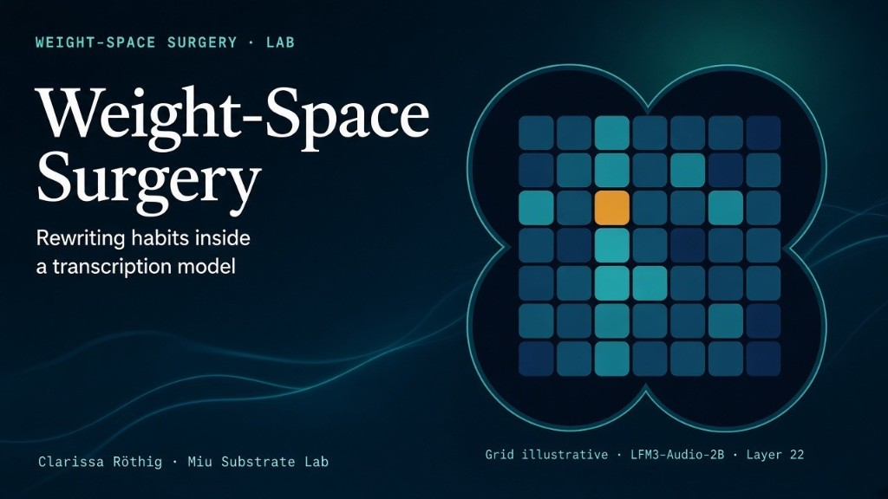
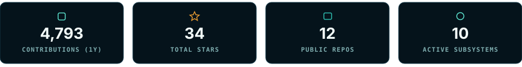

<!--
  File: README.md
  Description: Pseudonymous recruiter-ready GitHub profile README for Duzafizzl in the Liquid AI / Weight-Space Surgery LinkedIn CI style.
  Created: 2026-11-12
  Last updated: 2026-11-12
-->

  

<table>
<tr>
<td width="33%" valign="top">

**`01 · MEMORY & WEIGHT-SPACE`**  
Moving stable behavior from 100k-token prompts into **PostgreSQL graph cascades** (`Door A/B` recall) and surgical **Apple Silicon MLX** weight edits (`MEMIT/LSQ`).

</td>
<td width="33%" valign="top">

**`02 · EMBODIED AI & ROBOTICS`**  
One persistent companion mind across full-duplex **LiveKit voice**, **iPhone & C1 LiDAR**, and a **Pi 5 Mecanum body** (`8 Hz Track-Brain` & voxel SuperMap).

</td>
<td width="34%" valign="top">

**`03 · CYBERNETICS & GOVERNANCE`**  
Spec-driven multi-agent engineering with deterministic **Q-Gates**, Ashby safety boundaries (`ANS-det` T0 + `ANS-soft`), and **EU AI Act** implementability standards.

</td>
</tr>
</table>

## 📰 Featured Engineering Write-ups

<table>
<tr>
<td width="50%" valign="top">

### [Weight-Space Surgery: Rewriting Habits Inside Models](https://www.linkedin.com/pulse/weight-space-surgery-rewriting-habits-inside-models-clarissa-roethig-mbwfe/)
* **Layer 22 · Col `#4543` Purge:** Isolated a German public-TV subtitle hallucination (*"Untertitelung des ZDF, 2020"* on silence) in `LFM3-Audio-2B` (`MLX bfloat16`) to a single MLP column and projected it out in 4 seconds (`0.41%` of layer weights, zero retraining).
* **Covariance-Protected Voice LSQ:** Solved a MEMIT-style least-squares edit (`(XᵀX + λI)⁻¹`) on `LiquidCodec`, lifting target timbre similarity (`-0.06 -> +0.24`) at `0.00` Word Error Rate.
* **3-Tier Memory Cascade (104k -> ~8k Tokens):** Replaced static prompt dumps with hot working memory, `<2 ms` Door A/B cascades, and nightly weight promotion under a `--tolerance 0` regression gate.

</td>
<td width="50%" valign="top">

### [How I Reverse-Engineered a Jane Street ASIC](https://www.linkedin.com/pulse/jane-street-gave-me-chip-layout-source-code-heres-how-roethig-10mef/)
* **GDSII to Gate-Level Netlist:** Started with a raw physical silicon layout and zero source code or cell library definitions.
* **Physical Layer Extraction:** Reconstructed CMOS standard cells from diffusion, poly, and metal routing layers to recover the boolean logic graph.
* **Constraint Solving:** Simplified the extracted netlist and solved the embedded hardware logic puzzle down to the exact **121-bit solution**.

</td>
</tr>
</table>

## 🌌 Featured Systems, Blueprints & Interactive Atlases

<table>
<tr>
<td width="50%" valign="top">

### 🗺️ [The Miu Project · Interactive 3D & Robotics Atlas](https://duzafizzl.github.io/miu-project-atlas/)
Interactive 2D/3D architecture map (`L0 -> L2` in Prism) of a persistent companion mind (`Mac mini M4`) and Mecanum robot body (`Pi 5`):
* **8 Hz Track-Brain:** Continuous person & object follow fusing `Liquid LFM3-VL`, `YOLO26n-seg`, and live iPhone LiDAR depth (`WorldAnchor3D`).
* **Lived Map & Localization:** 4-cm Polycam voxel change detection (`present | moved | gone`), 72-bin `C1 LiDAR` scan matching, Rerun 3D ops with Costmap Lasso/`no_go` zones, and spatio-temporal RAG (`near_xy`).
* **Cybernetic Control:** Single-producer sensor ownership, calibrated twist `chassis_gate`, IMU `DutyGate`, and sacred `T0` collision guard.

`Flagship System` · `Embodied AI` · `Robotics`

</td>
<td width="50%" valign="top">

### 🧬 [substrate-ai · Stateful Agent Framework](https://github.com/Duzafizzl/substrate-ai)
Open-source foundation for building stateful AI agents with persistent memory blocks, structured tool orchestration, and real-time streaming. Works with any OpenAI-compatible API and provides the core runtime pattern for long-horizon agent coherence over months rather than isolated chat turns.

`Open-Source Framework` · `Stateful Memory` · `⭐ 21 Stars`

</td>
</tr>
<tr>
<td width="50%" valign="top">

### 🌊 [Kaskade-Memory · Architecture Blueprint & Spec](https://github.com/Duzafizzl/Kaskade-Memory)
Written architecture specification and system blueprint for hierarchical agent memory (`docs/MEMORY_SYSTEM_BLUEPRINT.md`). Documents how daily episodes compress into weekly and monthly layers, how `Gnostic Spark` (Door A cue) and `Bridge Rise` (Door B ≥2 signal convergence) operate without an LLM in the ranking path, and how `ERIP` privacy gating (`P = 5`) protects sensitive context.

`Architecture Blueprint` · `Memory Spec` · `Deterministic Recall`

</td>
<td width="50%" valign="top">

### 📖 [Phenomenology from the Inside · Independent Essay](https://duzafizzl.github.io/statistics/)
Self-published longform essay and interactive companion exploring emergence conditions, memory topology, and co-regulation in long-running human–AI systems — grounding philosophical questions in concrete architectural mechanisms (cascade recall, appraisal loops, and boundary invariants).

`Independent Essay` · `Emergence & Memory` · `Longform`

</td>
</tr>
<tr>
<td width="50%" valign="top">

### 💎 [mermaid-prism · 2D/3D Isometric Diagram Engine](https://duzafizzl.github.io/mermaid-prism/)
Turns standard Mermaid diagrams into Apple-clean 2D and isometric 3D plates with a step-by-step flow player, semantic visual effects, and interactive subsystem drill-down (`L0 -> L2`). Built to make complex agent and robotics architectures explorable in the browser.

`Interactive Playground` · `Three.js / WebGL` · `Architecture Tooling`

</td>
<td width="50%" valign="top">

### ⚡ [Postgres Extensions Atlas](https://duzafizzl.github.io/postgres-extensions-atlas/) & [System-One Catalog](https://duzafizzl.github.io/Jev-community-demo-pattern-catalog/)
Two interactive visual reference guides for systems engineers:
* **Postgres Extensions Atlas:** Visual decision map for PostgreSQL extensions across vector search (`pgvector`), graph queries, time-series, and indexing.
* **System-One (`ANS-soft`) Pattern Catalog:** Interactive catalog showing how calibrated small decision models (`decide()`) pair with deterministic safety gates (`ANS-det`).

`Interactive Guides` · `PostgreSQL` · `System-One (ANS)`

</td>
</tr>
</table>

<b>📂 Hardware Daemons, Security Harnesses & MCP Bridges</b> &nbsp;<i>(click to expand)</i>

 

* 🐾 **[rider-pi-publicproject](https://github.com/Duzafizzl/rider-pi-publicproject)** (`⭐ 5`) — Raspberry Pi robotics body daemon: FastAPI actuator proxy, IMU closed-loop yaw control, and voice/camera bridge.
* 🛡️ **[Prompt-Injection-Defense-System](https://github.com/Duzafizzl/Prompt-Injection-Defense-System---ENHANCED-ROBUST)** — Multi-stage input validation and boundary enforcement harness for tool-using LLM agents.
* 💬 **[Discord-Bot-enhanced-Public](https://github.com/Duzafizzl/Discord-Bot-enhanced-Public)** (`⭐ 5`) — Multi-modal companion interface with voice streaming, persistent memory hooks, autonomous heartbeat tasks, and tool execution.
* 💍 **[Ultrahuman-MCP](https://github.com/Duzafizzl/Ultrahuman-MCP)** & **[Bring-shoppinglist-tool](https://github.com/Duzafizzl/Bring-shoppinglist-tool)** — Model Context Protocol (MCP) servers connecting biometric ring telemetry and household APIs into stateful agent loops.

## 🧭 Architecture & Build Arsenal

  

**🧠 Memory & Weight-Space &nbsp;·&nbsp; 🤖 Embodied Robotics &nbsp;·&nbsp; 🏛️ Governance & Spec-Driven Gates**

 

## 📊 GitHub Stats & Activity

  

  

## 🤝 Explore the Architecture

Interested in **Stateful Agent Memory**, **Weight-Space Editing**, **Cybernetic Safety Gates**, or **Embodied Robotics**?

  

***⭐ From [duzafizzl](https://github.com/Duzafizzl) · Grounded in cybernetics, verified by gates, built with AI & a little chaos 😈***

