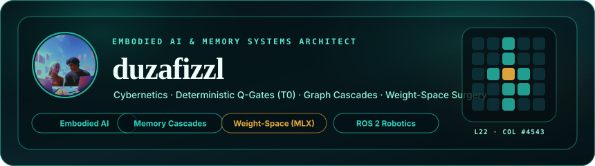
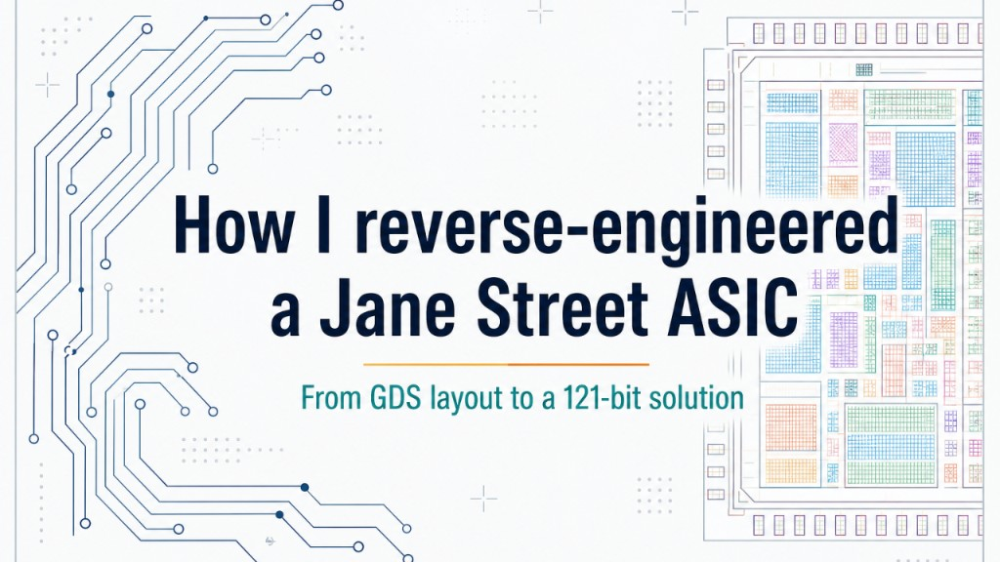

<!--
  File: README.md
  Description: Minimal, calm antfu-inspired GitHub profile README for Duzafizzl in the emerald/teal LinkedIn CI with 3D Contribution City.
  Created: 2026-11-12
  Last updated: 2026-11-12
-->

  

  <b>duzafizzl</b> · Embodied AI, Stateful Memory Architecture &amp; Operational AI Governance 
  Structure beats prompt bloat. Deterministic gates protect the body; cascades &amp; weights carry the mind.

  <a href="https://duzafizzl.github.io/miu-project-atlas/">Miu Project Atlas (3D)</a> ·
  <a href="https://duzafizzl.github.io/miu-project-atlas/atlas/robotics.html">Robotics Atlas</a> ·
  <a href="https://duzafizzl.github.io/postgres-extensions-atlas/">Postgres Atlas</a> ·
  <a href="https://duzafizzl.github.io/Jev-community-demo-pattern-catalog/">System-One Catalog</a>

<b>📰 Featured engineering write-ups</b>

 

<table>
<tr>
<td width="50%" valign="top">

**[Weight-Space Surgery: Rewriting Habits Inside Models](https://www.linkedin.com/pulse/weight-space-surgery-rewriting-habits-inside-models-clarissa-roethig-mbwfe/)**  
Isolated a German TV subtitle hallucination in <code>LFM3-Audio-2B</code> (<code>MLX bfloat16</code>) to <b>Layer 22 · Col #4543</b> and cut it in 4s via rank-1 projection — plus covariance-protected LSQ voice calibration (<code>0.00</code> WER) and a 104k → 8k token memory cascade.

</td>
<td width="50%" valign="top">

**[How I Reverse-Engineered a Jane Street ASIC](https://www.linkedin.com/pulse/jane-street-gave-me-chip-layout-source-code-heres-how-roethig-10mef/)**  
Started from a raw physical silicon layout (<code>GDSII</code>) with zero source code: reconstructed CMOS standard cells, traced metal routing into a gate-level netlist, and solved the hardware puzzle down to the exact <b>121-bit solution</b>.

</td>
</tr>
</table>

<b>📌 Top projects &amp; systems</b>

 

- **[miu-project-atlas](https://duzafizzl.github.io/miu-project-atlas/)** · [Repo](https://github.com/Duzafizzl/miu-project-atlas) — Interactive 2D/3D system &amp; [Robotics Atlas](https://duzafizzl.github.io/miu-project-atlas/atlas/robotics.html): persistent companion AI (`Mac mini M4` brain + `Pi 5` Mecanum body), **8 Hz Track-Brain** (`Liquid LFM3-VL` ∩ `YOLO26n-seg` ∩ iPhone LiDAR `WorldAnchor3D`), 4-cm Polycam voxel change detection, 72-bin `C1 LiDAR` localization, and sacred `T0` collision guard.
- **[substrate-ai](https://github.com/Duzafizzl/substrate-ai)** · ★ 21 — Open-source framework for stateful AI agents with persistent memory blocks, tool orchestration, and streaming.
- **[Kaskade-Memory](https://github.com/Duzafizzl/Kaskade-Memory)** — Deterministic hierarchical memory engine (`44` core blocks, `13,700+` revisions). Rolls days into weeks/months with `Door A` cue &amp; `Door B` convergence recall (zero LLM in rank path).
- **[mermaid-prism](https://github.com/Duzafizzl/mermaid-prism)** — Interactive 2D/3D isometric Mermaid renderer with step-by-step flow player, semantic effects, and subsystem drill-down.
- **[postgres-extensions-atlas](https://duzafizzl.github.io/postgres-extensions-atlas/)** · [Repo](https://github.com/Duzafizzl/postgres-extensions-atlas) — Interactive visual guide to PostgreSQL extensions for AI workloads, vector search, and graph indexing.
- **[Jev-community-demo-pattern-catalog](https://duzafizzl.github.io/Jev-community-demo-pattern-catalog/)** · [Repo](https://github.com/Duzafizzl/Jev-community-demo-pattern-catalog) — Pattern catalog for typed System-One (`ANS-soft`) decision models alongside deterministic guardrails.
- **[rider-pi-publicproject](https://github.com/Duzafizzl/rider-pi-publicproject)** · ★ 5 — Raspberry Pi robotics body daemon: FastAPI actuator proxy, closed-loop IMU yaw control, and voice bridge.
- **[Phenomenology from the Inside](https://duzafizzl.github.io/statistics/)** · [Repo](https://github.com/Duzafizzl/statistics) — Independent longform essay on emergence conditions, memory topology, and human-AI co-regulation.

<b>🧰 Architecture &amp; stack</b>

 

- **Memory &amp; Weight-Space:** PostgreSQL graph/cascade memory · Apple Silicon `MLX (bfloat16)` · Covariance-regularized MEMIT/LSQ weight editing · TensorFold nightly consolidation
- **Embodied AI &amp; Robotics:** ROS 2 Nav2 · C1 LiDAR &amp; iPhone LiDAR depth · Rerun 3D voxel/costmap ops · Calibrated Mecanum `chassis_gate` &amp; IMU `DutyGate` · LiveKit WebRTC full-duplex voice
- **Governance &amp; Engineering:** Spec-driven development · Multi-agent Turf &amp; Q-Gate verification harnesses · Ashby cybernetics (`ANS-det` T0 + `ANS-soft` Clef/Jev) · EU AI Act &amp; enterprise eval standards

<b>🏙️ The city I built this year</b>

 

<b>4,528</b> contributions across local-first &amp; public repositories (auto-synced via Mac mini Zero-Knowledge Mirror), <b>34</b> stars, and <b>12</b> public repositories.

  

Every building is a day; taller means more contributions.

<a href="https://github.com/Duzafizzl">duzafizzl</a> · Grounded in cybernetics, verified by gates, built for the real world.

